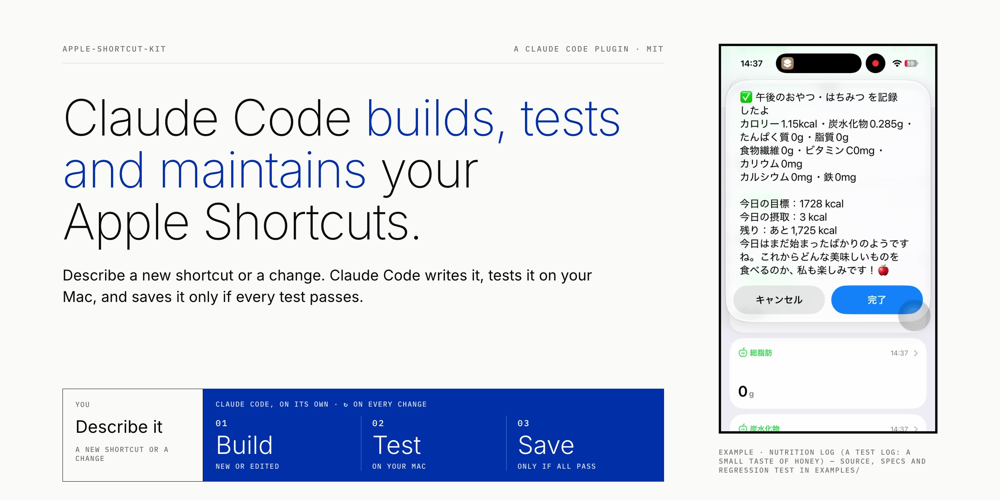
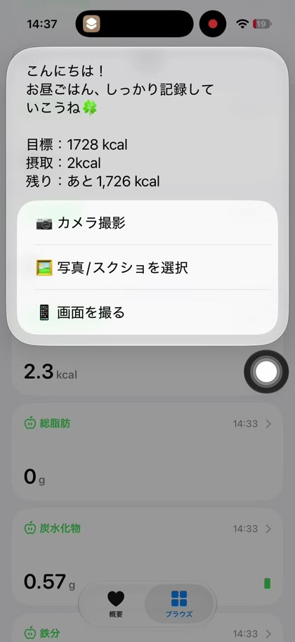
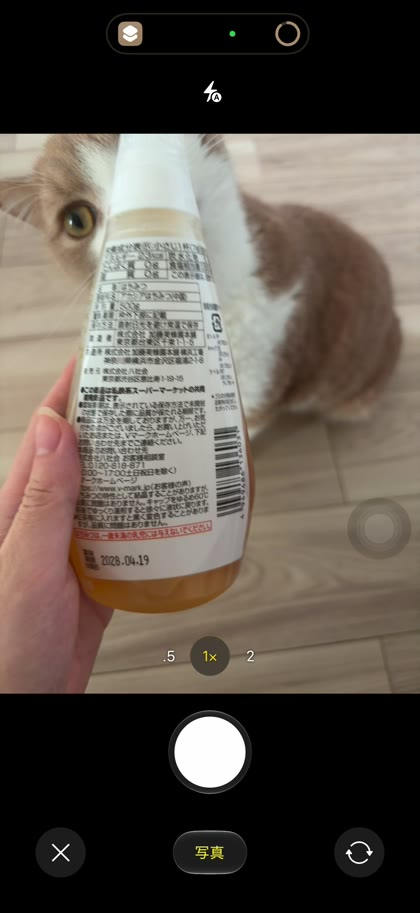
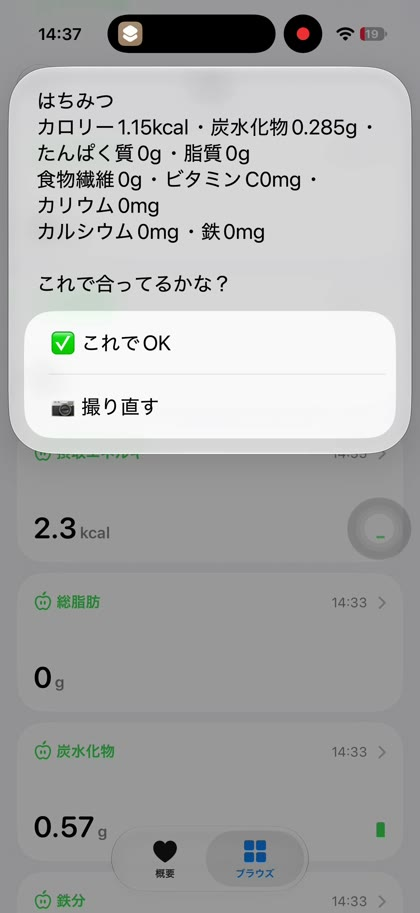
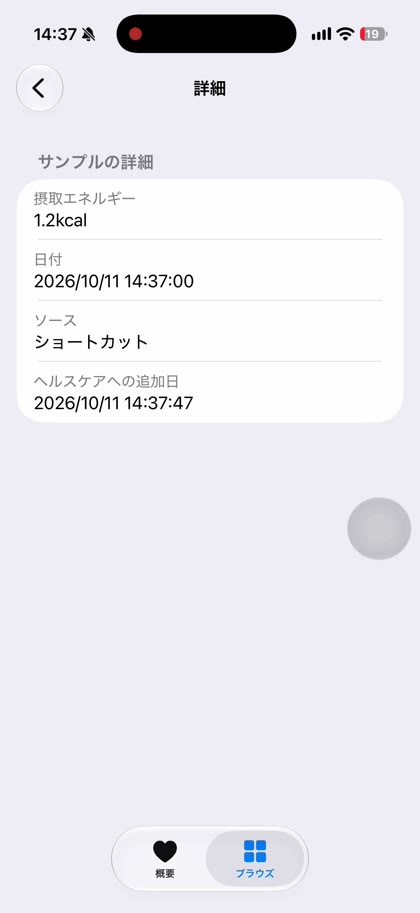
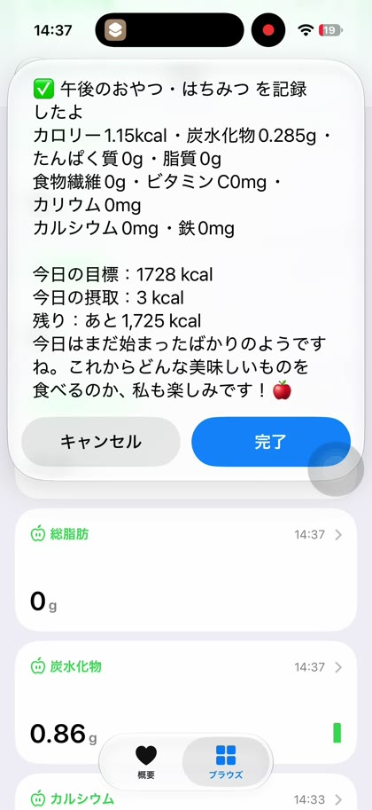

<sub>The record card on the cover is a test log: a small taste of honey, so 1.15 kcal is the real value.</sub>

<h3 align="center">
  <a href="#quickstart">Quickstart</a> |
  <a href="#whats-inside">What's inside</a> |
  <a href="#with-and-without-the-plugin">With and without the plugin</a> |
  <a href="#example-a-nutrition-log-built-and-maintained-this-way">Example</a>
</h3>

# apple-shortcut-kit

Claude Code builds any Apple Shortcut for you, and keeps it working through every change after.

## What you get

- **Describe a shortcut in plain words.** Claude Code writes the `.shortcut` file, signs it and opens the import dialog.
- **Every later change goes through the same tests.** A file that fails a test is never saved, so it never reaches your phone.
- **No guessed action settings.** Shortcuts does not check an action's settings, and a wrong one only fails when the
  shortcut runs. Claude Code copies each action's settings from a real example: your own shortcuts, Apple's sample
  shortcuts, or the examples bundled with the plugin. With no shortcuts of your own, it has examples for about 80
  action types, and about 480 with the [optional local library](#more-examples-optional).

<!-- DEMO VIDEO: uploaded as a GitHub attachment when the repo is published; the URL goes on the next line. -->

## How the kit builds and updates a shortcut

The same flow runs for a new shortcut and for every change after it. You describe what you want, Claude Code writes
the spec, and you approve it. Then Claude Code builds, tests and saves on its own, and only hands the file over when
every test passes.


<picture>
  <source media="(prefers-reduced-motion: reduce)" srcset="docs/change-flow-static.svg">
  
</picture>

Approving the spec is something Claude Code asks you for: an instruction to it, not a build check. With builtin tests,
a build without `specs/PRD.md` stops and saves nothing. Each tool in the diagram is described in
[What's inside](#whats-inside).

## What's inside

One line per file. What each one changes compared with Claude Code on its own is in
[With and without the plugin](#with-and-without-the-plugin).

| Step | Part | What it does |
|---|---|---|
| 0 Spec | `skills/shortcut-spec`, `templates/shortcut-prd-template.md` | Asks who, what and why, then writes `specs/PRD.md` as a draft for you to approve |
| 1 Build | `skills/shortcut-dev` | Tells Claude Code how to read, edit and build a shortcut |
| 1 Build | `scripts/shortcut_action_index.py` | Finds real examples of an action and its settings (`--check`, `--dump`, `--param`) |
| 1 Build | `examples/action-library/` | One example per action type the author has used (73 types), personal values replaced, as `.wflow` |
| 1 Build | `scripts/build_action_library.py` | Optional: builds a larger local library from ShortcutsBench ([More examples](#more-examples-optional)) |
| 1 Build | `scripts/probe_cleanup.py` | Deletes the `probe-` test shortcuts; its helper `kit-cleanup-probes` needs one **Add** click |
| 1 Build | `scripts/shortcut_io.py` | Reads and writes `.shortcut` files (`--tree`, `--prompts`) |
| 2 Test, 3 Save | `scripts/shortcut_build.py` | Runs every test, then signs, saves and opens the import dialog |
| 3 Save | `scripts/replace_old.py` | Deletes the old copy before an update is imported; its helper `kit-replace-old` needs one **Add** click |
| 2 Test | `scripts/audit_wiring.py` | Checks the wiring between steps |
| 2 Test | `scripts/ac_coverage.py` | Checks that every acceptance criterion has a test (builtin QA) |
| 2 Test | `skills/shortcut-qa`, `templates/regression_template.py` | Turns acceptance criteria into test cases and starts your regression script |
| First time | `scripts/doctor.py` | Checks your Mac and records which tests every build runs |
| Reference | `docs/apple_shortcuts_dev_protocol.md` | What the Shortcuts platform can and can't do |
| Reference | `docs/feishu-bitable.md` | How a shortcut writes records to Feishu (Lark) Bitable |

## With and without the plugin

The left column describes what Claude Code does on its own; it is not a measured comparison.

| | Claude Code on its own, with macOS `shortcuts` | With apple-shortcut-kit |
|---|---|---|
| **Idea to spec to test cases** | Asked for a spec, it often answers in the reply instead of a file, in a shape the coverage check can't read. It asks nothing before writing, decides open points without asking, gives no verdict per requirement, and can promise a run the platform doesn't guarantee, such as an unattended 7:00 automation | `shortcut-spec` asks who, what for and why up front, recommends how to build it (including any service with a web API), marks each requirement works, iPhone only, needs a workaround or needs an app, and lists what to check on your iPhone first. It writes `specs/PRD.md` marked draft, with its recommendations and each open question with the default it used. Or use your own spec tool and save its output as `specs/PRD.md` (for builtin tests, with stories as `### US-n` and acceptance criteria as `**ACm …**` lines). `shortcut-qa` then turns the acceptance criteria into a case matrix. Before building from a spec marked draft, Claude Code shows it and asks you to approve it. This is an instruction to Claude Code, not a build check |
| **Reading and editing a signed `.shortcut`** | The file is a signed archive. `shortcuts` can sign one but has no command that reads it back | `shortcut_io.py` unpacks it to its steps and repacks it, with no key needed |
| **A new action** | Written from memory | The build refuses an action type new to the file that has no real example in your shortcuts, Apple's samples or the kit's examples (the real-sample check) |
| **A setting value** | Written from memory. Shortcuts doesn't check settings and `shortcuts sign` signs anyway, so a wrong value shows up only when it runs | The skill has Claude Code look the value up in real examples first. With none, it stops and offers to test a guess on your Mac, or asks you to export a sample. This is an instruction to Claude Code, not a build check |
| **Wiring between steps** | Not checked. A step pointing at an output that isn't there, or a placeholder one position off after an emoji, still signs | The wiring audit (`audit_wiring.py`) runs before saving; a failure saves nothing |
| **Tests on every build** | Whatever Claude Code thinks of | The QA you chose. **builtin**: every acceptance criterion in `specs/PRD.md` has a case in `specs/ac-matrix.md` (`ac_coverage.py`), and your `scripts/*regression*.py` pass; without `specs/PRD.md` the build stops and saves nothing, and until `specs/ac-matrix.md` exists the coverage check is skipped and the build says so. **own**: your test command passes. **none**: the wiring audit and real-sample check only, and every build says so. Nothing then checks your acceptance criteria or regression script, so a broken feature shows up only when it runs on your iPhone |
| **First-time setup** | — | `doctor.py` checks the Mac and records which tests every build runs |
| **Installing** | `shortcuts` has run, list, view and sign, and no import | The import dialog opens once every test passes; you click **Add** |
| **Updating** | Importing again adds a second shortcut with the same name, and `shortcuts run <name>` then fails | The old copy is deleted first (one **Delete** click), then the import dialog opens |
| **Test shortcuts** | Stay in your library; `shortcuts` has no delete | `probe_cleanup.py` deletes the `probe-` ones (one **Delete** click) and checks that nothing else went |
| **More examples** | — | `build_action_library.py` builds a larger local library from ShortcutsBench, for your own use |
| **Platform facts** | The model's memory | A protocol of what the platform can and can't do, from tests on a Mac or iPhone and from desk research; the skill points Claude Code to the section it needs |
| **Unchanged** | You decide what the shortcut does, and check what only happens on the iPhone (Health writes, camera, layout, AI answers) with one run there | Same: you decide what the shortcut does and approve the spec; `shortcut-spec` lists which parts it recommended |

## What a shortcut can do

A shortcut can take a photo, ask Apple Intelligence, read and write Health, Calendar, Reminders and Notes, and call any
web API, so it can work as a small app on your iPhone. The example below uses the camera, Apple Intelligence and Health.


## Quickstart

1. Install the plugin:

   ```
   /plugin marketplace add lijingwu2026/claude-code-apple-shortcut-kit
   /plugin install apple-shortcut-kit@apple-shortcut-kit
   ```

2. In your project folder, ask Claude Code to "run the apple-shortcut-kit doctor" (it knows where the plugin is
   installed). It checks your Mac, lists the example shortcuts it found, and asks once which tests every build runs
   (see below).
3. Start with the spec: ask Claude Code to run `shortcut-spec`, or bring your own `specs/PRD.md` from any tool (for
   builtin tests, with stories as `### US-n` and acceptance criteria as `**ACm …**` lines).
4. Ask Claude Code for a new shortcut in plain words, or for a change, for example "add a step that asks for a note
   and appends it to the result". Shortcuts the kit built are already in your project folder. To change one you made
   in the Shortcuts app, export it there first (Share → Export File); macOS has no command that reads a shortcut out
   of the app.
5. Claude Code edits the file, runs the tests, and opens the import dialog only when all pass. Click **Add**. With
   iCloud sync on for Shortcuts, it appears on your iPhone.

The skills read the plugin's protocol from the plugin folder, which is outside your project folder, so Claude Code
may ask before that read. Allow it, or run `/add-dir "<plugin folder>"` once per session so it doesn't ask.

What the doctor runs:

```
python3 "<plugin folder>/scripts/doctor.py"           # checks macOS, python3 ≥ 3.10 and the shortcuts, aea, yaa, openssl tools
python3 "<plugin folder>/scripts/doctor.py" --setup   # which tests every build runs: own / builtin / none (asks once, or pass --qa)
```

Which tests every build runs:

- **own**: your own test command runs on every build.
- **builtin**: checks that your spec's acceptance criteria are all covered, and runs your `scripts/*regression*.py` if
  there is one. It needs `specs/PRD.md` with acceptance criteria, written with the `shortcut-spec` skill or brought
  from your own tool (step 3); the `shortcut-qa` skill derives `specs/ac-matrix.md` from them. Without `specs/PRD.md`
  the build stops and saves nothing.
- **none**: wiring audit and real-sample check only; every build says so. Without tests, nothing checks the spec's
  acceptance criteria or your regression script, so a change can break a feature and you see it only when it runs on
  your iPhone.

Where it finds examples: besides the examples bundled with the plugin and Apple's samples, the kit reads your
`.shortcut` files in your project folder, at the top of iCloud Drive and in the Shortcuts app's iCloud folder, and
the optional local library below.

## More examples (optional)

The bundled library covers the action types the author has used. For about 400 more, build a local library from
[ShortcutsBench](https://github.com/EachSheep/ShortcutsBench) on your Mac:

1. Download its raw shortcut dataset (linked in its README: a 750 MB zip, password `shortcutsbench`) and unzip it to
   get `1_final_detailed_records_remove_repeat.json` (1.5 GB).
2. Ask Claude Code to build the local library, or run:

   ```
   python3 "<plugin folder>/scripts/build_action_library.py" --sbench <path to the .json>
   ```

   It takes about 20 seconds and up to 8 GB of memory, and writes to
   `~/Library/Application Support/apple-shortcut-kit/action-library/`, where the kit finds it from then on.

ShortcutsBench is Apache-2.0, but its shortcuts come from sharing sites whose terms allow personal, non-commercial use
only, so the local library is for your own use: don't share it or ship it with a product. The build leaves out the
shortcuts that came from MacStories, whose terms don't allow this use. Some of the action types are older than the
current Shortcuts app and may no longer exist; the real-sample check still accepts them, so a shortcut that uses one
can fail when it runs.

## Example: a nutrition log built and maintained this way


<p>
  
  
  
  
  
</p>

## The tests test themselves

The build is tested by breaking shortcuts on purpose: broken wiring, a failing regression script, an action with no
real example. Each must be refused with the target file untouched. From `python3 scripts/shortcut_build.py --selftest`:

```
=== write-gate destroy cases (entrypoint=cli; each must block, keep target, open 0×) ===
  ✅ C6 offset shifted: blocked at 🔴 C6, target byte-identical, open 0×, tmp removed
  ✅ C1 dangling ref: blocked at 🔴 C1, target byte-identical, open 0×, tmp removed
  ✅ regression stub exits 1: blocked at gate 3, target byte-identical, open 0×, tmp removed
  ✅ identifier with no corpus sample: blocked at gate 4, target byte-identical, open 0×, tmp removed
```

## Limits

- **You still click and check a few things yourself.** Apple's `shortcuts` command has no import or delete, so the
  Shortcuts app asks you:
  - **Add** in the import dialog, for every new version. The first time, each helper shortcut (`kit-replace-old`,
    `kit-cleanup-probes`) needs one **Add** too.
  - **Delete** once when you update a shortcut that is already installed: the old copy goes first, so you never have
    two. Not yet checked: whether home-screen icons or automations linked to the old copy need adding again.
  - **Delete** once when Claude Code clears its test shortcuts. It deletes every shortcut whose name starts with
    `probe-`, including ones you made yourself; the dialog lists them first.
  - **Run it on your iPhone once.** Claude Code runs every test it can on your Mac; what only happens on the iPhone
    (Health writes, camera, layout, AI answers) you check there. Logging Health data on a Mac fails with an error.
- **Mac only.** The kit signs with the macOS `shortcuts sign -m anyone` command, which "will notarize via iCloud"
  (`man shortcuts`), so it needs a network connection.
- **`shortcuts sign` does not check action settings.** That is why the real-sample check exists. It is only as good as
  the examples it finds, and a shortcut you saved earlier today also counts as an example.
- **The library has one example per action type, from the author's own shortcuts, with its text and IDs blanked.**
  When a build needs a value no example shows, such as which existing note "Append to Note" writes to, Claude Code
  stops and asks you to export a one-action sample from the Shortcuts app, or offers to test its guess on your Mac
  first.

## Credits

The bundled examples come from the author's own shortcuts. The optional local library is built on your Mac from
[ShortcutsBench](https://github.com/EachSheep/ShortcutsBench) (Apache-2.0); this repo contains none of its shortcuts.

## License

MIT
